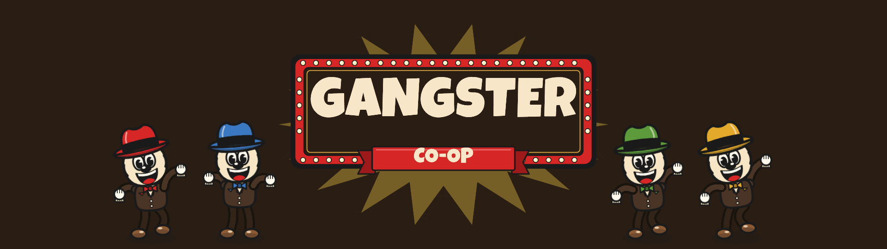
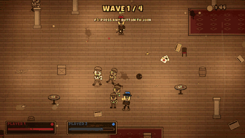

# Noodle Limbs



Rubber-hose cartoon limbs for Unity 2D (URP). Each arm or leg is one small, ink-outlined tube mesh,
rebuilt every frame along a curve between two joints. Move the hand, and the arm follows. Set `Bend`,
and it bows like a hose instead of hinging.



Extracted from [GangsterCoop](https://akashkapoordev.itch.io/gangstercoop-template), a 1930s rubber-hose
co-op roguelite, where every player and enemy limb is drawn this way.

## How it works

- **The curve:** a quadratic Bezier from the start joint to the end joint. Its control point sits at the
  midpoint, pushed sideways by `Bend × 2`, so the middle of the limb bows out by exactly `Bend`.
- **The mesh:** 8 segments by default (2 to 24). For each point along the curve, two vertices are pushed out
  along the normal. A half-disc fan caps each end. The whole thing is drawn twice: a wider outline layer, then
  the fill layer on top. That's one mesh and one draw per limb.
- **Fixed topology:** triangles are built once in `Awake`. Each frame only rewrites positions and colours,
  into preallocated arrays, so there are no per-frame allocations.
- **Lighting:** the shader is URP's 2D Sprite-Lit without the SpriteRenderer-only parts, so a plain
  `MeshRenderer` gets 2D lights, normal-less shape lighting and vertex colours like any sprite.
- **Colour space:** vertex colours are converted to linear in a linear-space project, to match how
  SpriteRenderer colours look.

### Why a mesh?

These are frame costs from the Unity Editor with 60 enemies on screen, measured while choosing the approach.
They aren't a formal benchmark.

| Approach | Frame cost |
|---|---|
| Sliced sprites per limb | ~55 ms |
| Sprites with per-renderer material overrides | ~16 ms |
| One dynamic mesh per limb (this) | ~4.5 ms |

## Install

In Unity 6 (6000.0 or newer), open **Window → Package Manager → + → Install package from git URL** and paste:

```
https://github.com/akashkapoordev/unity-noodle-limbs.git
```

Your project needs URP with a 2D Renderer.

## Use

1. Create a GameObject under your character, for example `FrontArm`.
2. Add a **Sprite Renderer** with no sprite. Give it a material that uses the `NoodleLimbs/NoodleLimb` shader,
   and set the sorting layer you want. This renderer is only a template: the limb copies its material and
   sorting layer, then disables it.
3. Add **Noodle Limb** and drag in the start joint (the shoulder) and the end joint (the hand).
4. Animate the joints however you like (code, Animator, IK). The limb runs in `LateUpdate` at execution
   order 200, after they've moved.

```csharp
limb.SetJoints(shoulder, hand);
limb.Bend = Mathf.Sin(Time.time * 3f) * 0.2f; // bow sideways (parent's local units)
limb.Width = 0.12f;
limb.Fill = sleeveColour;
limb.Tint = Color.red;                        // multiplies both colours: hit flash, fade
limb.SortingOrder = 5;                        // back arm behind the body, front arm in front
```

Widths are in the parent's local units, so scaling the character scales its limbs.

### Sample

Import **Waving Arm** from the package's Samples tab. Put `WavingArmDemo` on an empty GameObject in a
URP 2D scene and press Play. It builds a shoulder, a hand and a limb in code and swings them.

The sample finds the shader with `Shader.Find`, which only works in a build if something references the shader.
In a real project, use a material asset.

## Licence

[MIT](LICENSE), for the code and shader. The images in `Documentation~` show GangsterCoop, which is a separate
commercial project and isn't covered by that licence.
